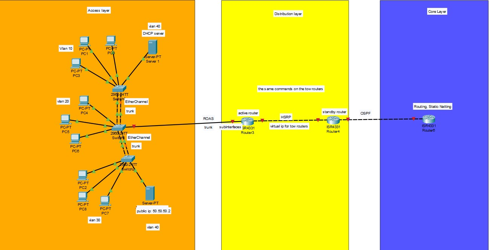

# Org-networking

## Topology

## Description
Planning, designing and implementing the network of a company
(name: TBD) using Cisco Packet Tracer. The network uses VLSM,
OSPF, VLANs with Router-on-a-Stick, a standalone DHCP server,
AAA, EtherChannel, HSRP, SSH and Static NAT for a public web
server (50.50.50.2).

## Requirements
- VLSM (variable subnetting)
- 01 - OSPF as the routing protocol
- 02 - VLANs with inter-VLAN routing using ROAS
- 03 - Standalone DHCP server
- 04 - AAA authentication with a local admin user
- 05 - First name as the password for all lines
- 06 - Second name as the enable (privileged exec) password
- 07 - Web server with public IP 50.50.50.2 (Static NAT)
- 08 - EtherChannel between switches
- 09 - HSRP for router redundancy
- 10 - SSH on at least one router
- 11 - PDF documentation with screenshots and simple explanations
## Team and Responsibilities
| Member | Tasks |
|:---:|:---:|
| Mahmoud El-Sheikh | 4 (AAA), 7 (Static NAT), 9 (HSRP), 10 (SSH) |
| Mohamed Fathallah | 2 (VLANs + ROAS), 3 (DHCP), Subnetting (VLSM) |
| Youssef Emad | 1 (OSPF), 8 (EtherChannel), Documentation |
| Fady Yacoub | 5 (line passwords), 6 (enable password), Documentation |

## Topology
File: topology/proj-topology.pkt
(Add a screenshot of the topology here)

## Addressing Plan (VLSM)
(To be filled by the Subnetting owner)

## Repository Structure
- topology/     Packet Tracer file
- configs/      Device configurations (text files)
- docs/         Documentation parts for the final PDF
- screenshots/  Screenshots per requirement
