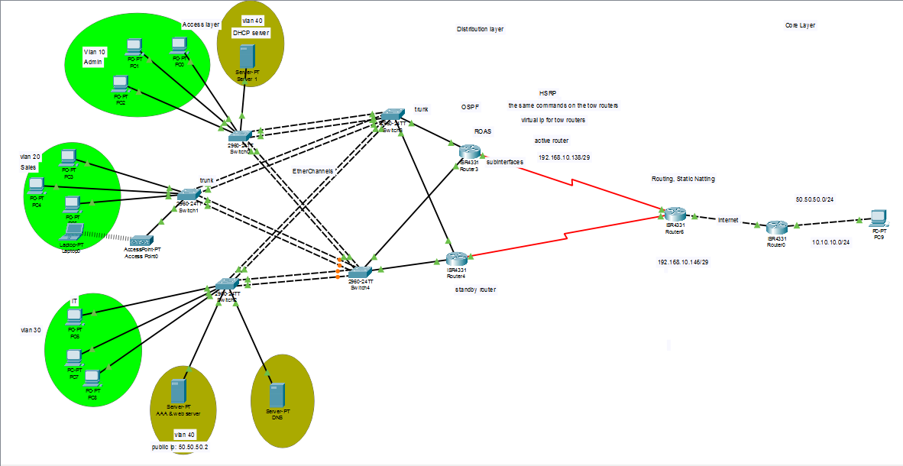

# Verse networking: Enterprise Network (CCNA project)

A three-layer enterprise network designed and implemented in Cisco Packet Tracer
with VLSM, VLANs with ROAS, standalone DHCP, OSPF, EtherChannel, HSRP, AAA, SSH
and Static NAT.

## Team

| Member | Tasks |
|:---|:---|
| Mahmoud El-Sheikh | AAA, Static NAT, HSRP, SSH |
| Mohamed Fathallah | VLANs + ROAS, DHCP, VLSM |
| Youssef Emad | OSPF, EtherChannel, Documentation |
| Fady Yacoub | Line passwords, enable secret, Documentation |

Supervised by Dr. Ekram Abdelwahab.

## Requirements

| # | Requirement |
|:---:|:---|
| 0 | Variable subnetting (VLSM) |
| 1 | OSPF |
| 2 | VLANs with inter-VLAN routing (ROAS) |
| 3 | Standalone DHCP server |
| 4 | AAA with a local admin user |
| 5 | Line passwords |
| 6 | Enable secret |
| 7 | Static NAT for the web server (50.50.50.2) |
| 8 | EtherChannel |
| 9 | HSRP |
| 10 | SSH |
| 11 | PDF documentation |

## Repository contents

- `docs/`: full project report (PDF) with explanations and screenshots
- `topology/`: topology image and the Packet Tracer file (`.pkt`)
- `configs/`: `running-config` of every router and switch
- `screenshots/`: verification outputs

## How to open the lab

1. Install Cisco Packet Tracer [9.1.0].
2. Open `topology/proj-topology.pkt`.
3. The device configurations are also available as text in `configs/`.

## Tools

Cisco Packet Tracer
